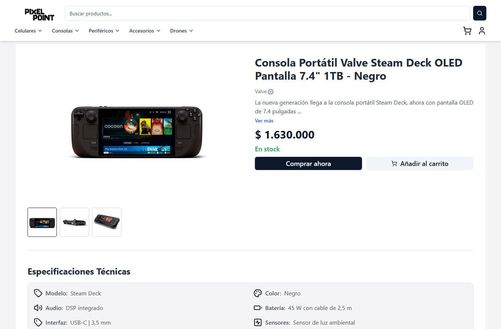
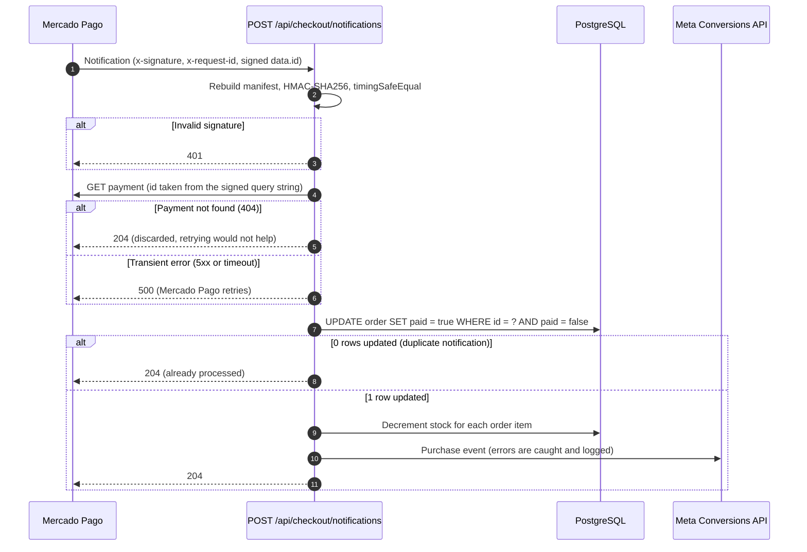
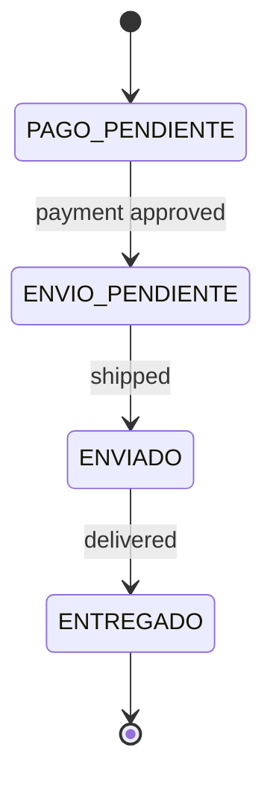
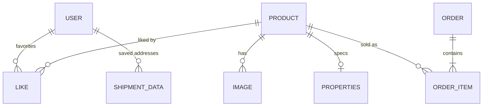

<div align="center">

# 🛒 Pixel Point

**Production e-commerce for an electronics shop in Argentina.**
Mercado Pago payments with signed, idempotent webhooks · role-based admin dashboard · end-to-end tests in CI.

[](https://github.com/Kev-Villegas/pixel-point-ecommerce/actions/workflows/playwright.yml)


[**Live site**](https://www.pixel-point.com.ar) · [Architecture](#architecture) · [Engineering notes](#engineering-notes) · [Run it locally](#run-it-locally)



</div>

## Overview

Pixel Point sells phones, consoles, peripherals, accessories and drones. Customers browse by category and brand, keep favorites, pay with Mercado Pago and follow their orders. The shop owner runs the business from an admin dashboard with sales metrics. The interface is in Spanish.

It runs in production and was built end to end as freelance work: data model, API, payments, authentication, admin panel and tests.

## Highlights

| Area | What is implemented |
| --- | --- |
| **Payments** | Mercado Pago checkout. The webhook is authenticated with HMAC-SHA256 (constant-time comparison), idempotent under retries, and safe against out-of-order delivery. |
| **Auth** | NextAuth v5 (Prisma adapter, JWT sessions), email and password or Google, email verification, `ADMIN` / `USER` roles enforced in middleware. |
| **Data** | PostgreSQL with Prisma 7 (`pg` adapter). 19 migrations, including the move from MySQL to PostgreSQL. |
| **Admin** | Product management with Cloudinary uploads, order and shipping status, KPIs, monthly trends and best sellers (Recharts). |
| **Analytics** | Meta Pixel plus server-side Conversions API events, deduplicated with the browser event id. |
| **Quality** | Strict TypeScript, ESLint, Prettier, Husky and lint-staged. Playwright end-to-end tests in GitHub Actions. |

## Architecture

### Payment webhook

Mercado Pago retries notifications and can deliver them out of order, so the handler is built to be safe under both.



### Order status flow



### Data model



Products are grouped in categories (`SMARTPHONE`, `CONSOLE`, `PERIPHERAL`, `ACCESSORY`, `DRONE`, `OTHER`). Orders keep a snapshot of the buyer and shipping data, so history survives account changes.

## Features

**Customers**

- Browse by category and brand, search products, save favorites.
- Cart and checkout with Mercado Pago: the preference is created on the server and the payment form is embedded in the checkout.
- Sign in with email and password or Google. Email verification is required before orders and favorites.
- Order history with a status flow: `PAGO_PENDIENTE` → `ENVIO_PENDIENTE` → `ENVIADO` → `ENTREGADO`.

**Admin**

- Product management with image uploads (Cloudinary).
- Orders and shipping status.
- Dashboard with KPIs, sales summary, monthly trends and best sellers.

## Engineering notes

**Payments** (`app/api/checkout`)

- The webhook is authenticated: the `x-signature` header is checked with HMAC-SHA256 over the documented manifest and compared in constant time. The payment id comes from the signed query string, not from the body, and the payment is then fetched from Mercado Pago's API.
- Notifications are idempotent. The order is marked as paid by one conditional `UPDATE ... WHERE paid = false`. Only the first notification matches, and only that one discounts stock.
- Out-of-order notifications cannot revert an order that was already paid. Unknown payments (404) are acknowledged so they are not retried forever. Transient errors (5xx) return an error so Mercado Pago retries.
- Purchase and checkout events are also sent server-side to the Meta Conversions API, deduplicated with the browser event id. A Meta failure never affects the order.

**Access control**

- NextAuth v5 with a Prisma adapter and JWT sessions. Roles `ADMIN` and `USER`.
- Middleware keeps `/protected/*` for admins and sends unverified accounts to email verification before `/orders` and `/favorites`.

**Data**

- PostgreSQL with Prisma 7 (`pg` adapter) and 19 migrations.
- A product catalog feed for Meta at `/api/fb-catalog`.

**Quality**

- Strict TypeScript, ESLint and Prettier, Husky and lint-staged on commit.
- Playwright end-to-end tests in `tests/`: sign-in, registration, form validation and a checkout against Mercado Pago's sandbox. They run in GitHub Actions on every push and pull request.

## Tech stack

| Layer | Technologies |
| --- | --- |
| **Frontend** | Next.js 16 (App Router), React 18, TypeScript, Tailwind CSS with Radix UI, Zustand, SWR, React Hook Form, Recharts, Framer Motion |
| **Backend** | Route Handlers and Server Actions, NextAuth v5, Prisma 7, PostgreSQL |
| **Integrations** | Mercado Pago, Cloudinary, Meta Pixel and Conversions API |
| **Quality** | Playwright, ESLint, Prettier, Husky, lint-staged, GitHub Actions |

## Project structure

```text
app/
  api/            Route handlers: checkout, products, orders, favorites, likes, dashboard, verification, fb-catalog
  actions/        Server Actions: sign-up, email verification, product queries
  protected/      Admin dashboard (ADMIN only)
  _components/    UI components (primitives in ui/, plus admin/, auth/, navbar/)
  _hooks/ _lib/ _schemas/ _utils/
  auth/ cart/ checkout/ orders/ favorites/ brands/ faq/     Pages
store/            Zustand stores: cart, filters, likes, search, device id, user info
prisma/           schema.prisma, 19 migrations, seed.ts
tests/            Playwright specs
middleware.ts     Route protection: admin gate and email-verification gate
```

## Run it locally

Requires Node.js 20+ and a PostgreSQL database.

```bash
npm install
# create .env with the variables below
npx prisma migrate deploy
npx prisma db seed
npm run dev
```

Variables the code reads:

| Variable | Used for |
| --- | --- |
| `DATABASE_URL` | PostgreSQL connection |
| `AUTH_SECRET`, `GOOGLE_CLIENT_ID`, `GOOGLE_CLIENT_SECRET` | NextAuth |
| `ACCESS_TOKEN`, `NEXT_PUBLIC_PUBLIC_KEY`, `MP_WEBHOOK_SECRET` | Mercado Pago (credentials and webhook secret) |
| `CLOUDINARY_API_KEY`, `CLOUDINARY_API_SECRET`, `NEXT_PUBLIC_CLOUDINARY_CLOUD_NAME` | Image uploads |
| `META_PIXEL_ID`, `NEXT_PUBLIC_META_PIXEL_ID`, `FB_CONVERSION_API_TOKEN` | Meta Pixel and Conversions API |
| `NEXT_PUBLIC_URL` | Base URL used by the app and by the Playwright suite |

## Testing

```bash
npx playwright test
```

The suite covers sign-in, registration, form validation and a checkout against Mercado Pago's sandbox. The workflow in [`.github/workflows/playwright.yml`](.github/workflows/playwright.yml) runs it on every push and pull request and uploads the Playwright report as an artifact.

## Known limitations and next steps

- CI runs the Playwright suite against the deployed site. Next: run it against a local server with a seeded database, so a test run never depends on production.
- The workflow only runs the end-to-end tests. Next: add lint, type-check and build steps.
- The paid-flag update and the stock decrement in the webhook are separate statements. The idempotency guard makes retries safe, but a crash between the two would leave stock undiscounted. Next: wrap both in a single `$transaction`.
- Some `any` types remain in the API routes. Next: move them to shared, validated schemas.

## Author

Built by [Kevin Villegas](https://github.com/Kev-Villegas) · [Portfolio](https://www.kevcode.com.ar) · [LinkedIn](https://www.linkedin.com/in/kevin--villegas)
